# Orders API — Serverless REST API con AWS Lambda y API Gateway

API REST de gestión de órdenes implementada en **Java 17 + Maven**, desplegada en **AWS Lambda**
y expuesta con **Amazon API Gateway** de dos formas:

- **Arquitectura A:** integración *no-proxy* (API Gateway transforma requests y responses con mapping templates).
- **Arquitectura B:** *Lambda proxy integration* (un adaptador HTTP delgado en Java).

La lógica de negocio es la misma en ambas y no depende de AWS.

---

## Índice

1. [Estructura del proyecto](#1-estructura-del-proyecto)
2. [Compilar y probar](#2-compilar-y-probar)
3. [Contrato del API](#3-contrato-del-api)
4. [Preguntas de diseño](#4-preguntas-de-diseño-sección-4)
5. [Checkpoint 1](#5-checkpoint-1)
6. [Parte II — Lambda directa y serialización](#6-parte-ii--lambda-directa-y-serialización)
7. [Arquitectura A — mapping templates](#7-arquitectura-a--mapping-templates)
8. [Arquitectura B — proxy + adaptador HTTP](#8-arquitectura-b--proxy--adaptador-http)
9. [Comparación de arquitecturas](#9-comparación-de-arquitecturas)
10. [Revisión crítica de decisiones](#10-revisión-crítica-de-decisiones)
11. [Extensión: DELETE](#11-extensión-delete)
12. [Errores internos inesperados](#12-errores-internos-inesperados)
13. [Arquitectura final](#13-arquitectura-final)
14. [Ejemplos de requests y responses](#14-ejemplos-de-requests-y-responses)

---

## 1. Estructura del proyecto

```
orders-api/
├── pom.xml
├── README.md
├── docs/
│   ├── DEPLOY_NOTES.md            # Funciones Lambda, handlers y eventos de prueba
│   ├── ARCH_A_GATEWAY_SETUP.md    # Configuración de API Gateway (no-proxy)
│   ├── ARCH_B_PROXY_SETUP.md      # Configuración de API Gateway (proxy)
│   ├── DECISIONS.md               # Decisiones de diseño (D1–D14)
│   ├── DELETE_PREDICTION.md       # Predicción previa al DELETE + comparación
│   └── img/                       # Capturas de Lambda, API A y API B
├── events/                        # JSON para invocar Lambdas y eventos proxy reales
├── scripts/
│   ├── aws/deploy.sh              # Despliegue reproducible de Lambdas + ambos APIs (CloudShell)
│   ├── test-arch-a.sh             # curl contra la arquitectura A
│   └── test-arch-b.sh             # curl contra la arquitectura B
└── src/
    ├── main/java/com/orders/
    │   ├── domain/                # Order, CreateOrderRequest, excepciones   ── Java puro
    │   ├── application/           # OrderService, OrderRepository, ids      ── Java puro
    │   ├── persistence/           # InMemoryOrderRepository                 ── Java puro
    │   └── lambda/                                                          ── depende de AWS
    │       ├── common/            # Formato de error, Jackson, composition root
    │       ├── mapping/           # Handlers de la arquitectura A
    │       └── proxy/             # Adaptador HTTP de la arquitectura B
    └── test/java/com/orders/      # 52 tests JUnit 5 (ninguno necesita AWS)
```

## 2. Compilar y probar

Requisitos: JDK 17+ y Maven 3.8+.

```bash
mvn test        # ejecuta los tests
mvn package     # genera target/orders-api-1.0.0.jar (fat JAR para Lambda)
```

Desplegar en AWS (desde AWS CloudShell, con el JAR en la misma carpeta):

```bash
./scripts/aws/deploy.sh arch-a     # 4 Lambdas + REST API orders-api-mapping
./scripts/aws/deploy.sh arch-b     # 1 Lambda  + REST API orders-api-proxy
./scripts/aws/deploy.sh urls       # muestra las URLs
```

URLs desplegadas durante el taller (pueden dejar de existir cuando se cierre el laboratorio):

- Arquitectura A: `https://s6y5le8d02.execute-api.us-east-1.amazonaws.com/prod`
- Arquitectura B: `https://f034suuipj.execute-api.us-east-1.amazonaws.com/prod`

Probar el API desplegado (desde Git Bash en Windows):

```bash
API_URL=https://<api-id>.execute-api.<region>.amazonaws.com/prod ./scripts/test-arch-b.sh
```

| Test | Qué cubre |
|---|---|
| `OrderServiceTest` | Creación válida, consulta existente, orden inexistente, búsqueda por cliente, entradas inválidas, borrado |
| `MappingHandlersTest` | Handlers de la arquitectura A (incluido DELETE) y que sus errores coincidan con los regex de API Gateway |
| `OrdersApiHandlerTest` | Adaptador HTTP con eventos simulados y con un evento **real** capturado: 200, 201 + Location, 204, 400, 404, 405, 500 |
| `ArchitectureTest` | Que `domain`, `application` y `persistence` no importen AWS, Jackson ni HTTP |

## 3. Contrato del API

Todas las respuestas con cuerpo usan `Content-Type: application/json`.

| Operación | Método y URL | Path params | Query params | Body | Éxito | Errores |
|---|---|---|---|---|---|---|
| Crear orden | `POST /orders` | — | — | `{customerId, product, quantity}` | **201** + orden + `Location: /orders/{id}` | 400 `INVALID_REQUEST`, 400 `MALFORMED_JSON`, 500 |
| Consultar orden | `GET /orders/{id}` | `id` | — | — | **200** + orden | 404 `ORDER_NOT_FOUND`, 500 |
| Buscar por cliente | `GET /orders?customerId=` | — | `customerId` (obligatorio) | — | **200** + array (puede ser `[]`) | 400 `INVALID_REQUEST`, 500 |
| Eliminar orden | `DELETE /orders/{id}` | `id` | — | — | **204** sin cuerpo | 404 `ORDER_NOT_FOUND`, 500 |

Reglas de validación: `customerId` y `product` obligatorios y no vacíos; `quantity` entero ≥ 1.
El `id` lo asigna el servidor (`ORD-001`, `ORD-002`, …); si el cliente envía uno, se ignora.

**Formato único de error:**

```json
{ "error": "ORDER_NOT_FOUND", "message": "Order ORD-999 does not exist" }
```

| Código | HTTP | Cuándo |
|---|---|---|
| `INVALID_REQUEST` | 400 | Falta un campo, está vacío o `quantity < 1` |
| `MALFORMED_JSON` | 400 | Body ausente, JSON inválido o tipo incorrecto (`"quantity": "abc"`) |
| `ORDER_NOT_FOUND` | 404 | La orden no existe |
| `METHOD_NOT_ALLOWED` | 405 | Método no soportado sobre un recurso (solo arquitectura B) |
| `INTERNAL_ERROR` | 500 | Error inesperado; sin detalles internos |

Datos precargados en cada instancia: `ORD-100` y `ORD-101` (CUST-42), `ORD-102` (CUST-7).

## 4. Preguntas de diseño (sección 4)

**¿Cuáles son los recursos del API?**
Un solo recurso: **Order**. Se expone como colección (`/orders`) y como elemento individual
(`/orders/{id}`). El cliente no es un recurso propio; solo es un atributo por el que se filtra.

**¿Por qué `/orders/{id}` para consultar una orden?**
Porque el `id` identifica de forma única a un elemento dentro de la colección. Es la convención
REST colección/elemento: la URL es estable y la misma sirve para otras operaciones sobre esa
orden (por ejemplo `DELETE /orders/{id}`), cambiando solo el método HTTP.

**¿Por qué `customerId` es un query parameter?**
Porque no identifica un recurso, sino que **filtra** la colección: `/orders?customerId=X` es un
subconjunto de `/orders`. Permite combinar filtros sin crear rutas nuevas
(`?customerId=X&product=Y`). La alternativa `/customers/{id}/orders` implicaría modelar
*Customer* como recurso, cosa que este API no hace.

**¿Qué debe devolver `POST /orders` si la orden se crea correctamente?**
`201 Created`, la orden completa (con el `id` asignado por el servidor) y el header
`Location: /orders/{id}` que apunta al nuevo recurso. Así el cliente no necesita otro GET.

**¿Qué debe devolver el API si una orden no existe?**
`404 Not Found` con el JSON de error `ORDER_NOT_FOUND`. No `200` con `null` ni `204`: el recurso
pedido no existe. En cambio, una **búsqueda** sin resultados devuelve `200 []`, porque buscar en
una colección y no encontrar nada es un resultado válido.

**¿Qué información debe contener una respuesta de error?**
Un código estable para máquinas (`error`) y un mensaje legible para personas (`message`), con
el mismo formato en todos los endpoints. Nunca stack traces ni nombres de clases internas.

## 5. Checkpoint 1


| Pregunta | Respuesta |
|---|---|
| ¿Se puede probar sin AWS? | Sí. `OrderServiceTest` usa Java puro; incluso los handlers se prueban sin AWS. |
| ¿Requiere un servidor web? | No. No hay Tomcat, Jetty ni nada que escuche en un puerto. |
| ¿Requiere Spring Boot? | No. Solo depende de las librerías de Lambda y de Jackson (en la capa `lambda`). |
| ¿Qué contiene el JAR? | Nuestras clases compiladas **más** las dependencias (aws-lambda-java-core, aws-lambda-java-events, Jackson) gracias a `maven-shade-plugin`. Es un *fat JAR* listo para subir a Lambda. |
| ¿Qué partes conocen HTTP? | Ninguna de `domain`, `application` ni `persistence` (lo verifica `ArchitectureTest`). Solo `lambda.proxy.OrdersApiHandler` conoce status codes y headers. En la arquitectura A nadie en Java conoce HTTP: eso lo resuelve API Gateway. |

## 6. Parte II — Lambda directa y serialización

Función `orders-create` con handler `com.orders.lambda.mapping.CreateOrderHandler::handleRequest`.
Detalles y eventos de prueba en [`docs/DEPLOY_NOTES.md`](docs/DEPLOY_NOTES.md).

### ¿Cómo convierte el runtime de Java el JSON en objetos y viceversa?

1. Lambda recibe el evento como **bytes JSON**.
2. El runtime de Java mira el tipo genérico del handler: `RequestHandler<CreateOrderRequest, Order>`.
3. Con su serializador interno (basado en Jackson) crea un `CreateOrderRequest` usando el
   **constructor sin argumentos** y llama a los **setters** según los nombres de los campos JSON.
4. Llama a `handleRequest(input, context)`.
5. Toma el objeto devuelto (`Order`) y lo serializa a JSON usando los **getters**
   (`getId()` → `"id"`, etc.).
6. Si el handler lanza una excepción, el runtime devuelve
   `{"errorMessage", "errorType", "stackTrace"}` y la invocación se marca como fallida.

### Configuración en la consola

| Paso | Captura |
|---|---|
| Crear la función (Java 17) | [00-crear-funcion.png](docs/img/lambda/00-crear-funcion.png) |
| Rol de ejecución `LabRole` (AWS Academy no permite crear roles) | [01-rol-labrole.png](docs/img/lambda/01-rol-labrole.png) |
| Función creada | [02-funcion-creada.png](docs/img/lambda/02-funcion-creada.png) |
| Subir el fat JAR (3,48 MB) | [03-subir-jar.png](docs/img/lambda/03-subir-jar.png) |
| Handler por defecto (`example.Hello`) que hay que cambiar | [04-handler-por-defecto.png](docs/img/lambda/04-handler-por-defecto.png) |
| Handler configurado | [05-handler-configurado.png](docs/img/lambda/05-handler-configurado.png) |
| Memoria 512 MB, timeout 15 s | [06-memoria-timeout.png](docs/img/lambda/06-memoria-timeout.png) |

### Experimentos y resultados observados

| # | Experimento | Entrada | Resultado observado | Qué demuestra |
|---|---|---|---|---|
| 1 | Primera invocación | `create-order.json` | `ORD-001`, **Init Duration 354 ms** | *Cold start*: arranque de la JVM y carga de clases |
| 2 | Invocar de nuevo ~35 min después | `create-order.json` | `ORD-001` **otra vez** | La instancia anterior se recicló: la memoria **no es persistente** |
| 3 | Invocar inmediatamente después | `create-order.json` | `ORD-002` | Instancia *warm*: reutiliza la JVM y el repositorio en memoria |
| 4 | Campos desconocidos | `create-order-2.json` (con `"id":"ORD-HACKED"` y `"color"`) | `ORD-003`; `id` y `color` ignorados | El runtime ignora propiedades que no tienen setter |
| 5 | Validación de negocio | `create-order-invalid.json` | Error, `errorType` = `GatewayErrorException`, `errorMessage` = `{"error":"INVALID_REQUEST","message":"product is required"}` | Nuestro código se ejecutó y lanzó la excepción |
| 6 | Tipo incorrecto (`"quantity":"abc"`) | `create-order-wrong-type.json` | Error, `errorType` = `java.lang.RuntimeException`, `errorMessage` = `An error occurred during JSON parsing`, `stackTrace` **vacío** | Falla el runtime **antes** de llamar a nuestro handler |

**1. Cold start (primera invocación)**

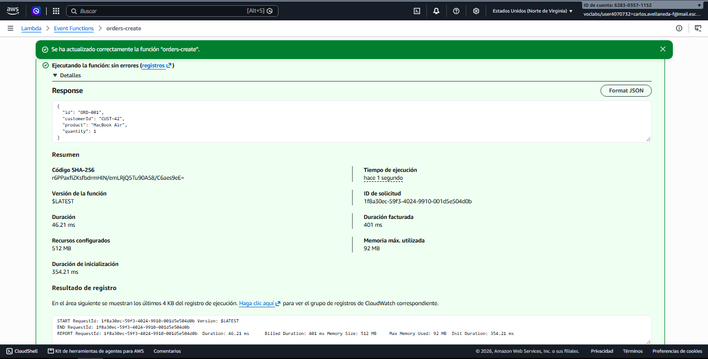

**2. Nueva instancia: vuelve a ORD-001**

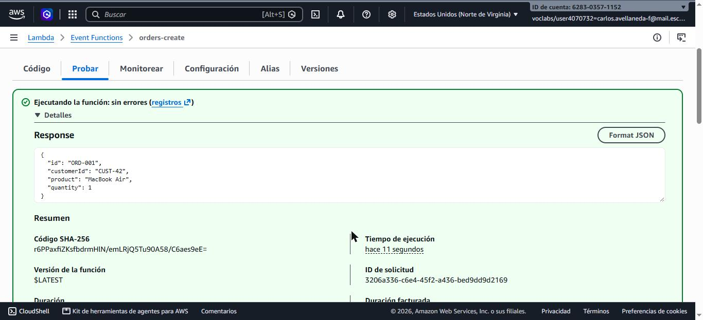

**3. Instancia warm: ORD-002**

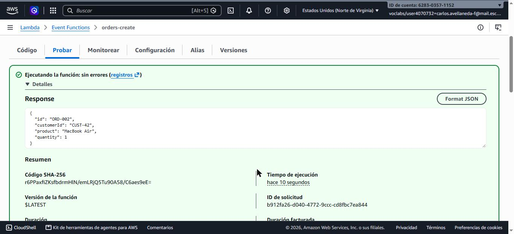

**4. Campos extra ignorados**


**5. Error de validación**

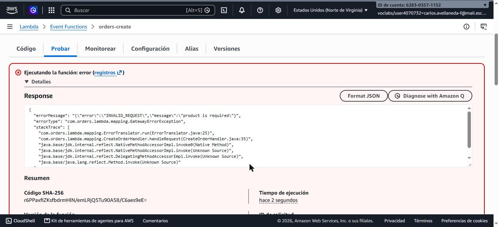

**6. Error de parseo del runtime**

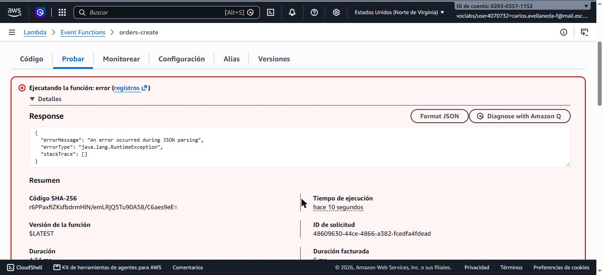

### Conclusión


El código Java nunca ve JSON. El runtime de Lambda lee el tipo genérico declarado en
`RequestHandler<CreateOrderRequest, Order>`, crea el objeto de entrada con el constructor vacío y
los setters (convención JavaBean) y serializa el valor de retorno con los getters. Lo verificamos así:

- **Campos sin setter se ignoran** (experimento 4): enviar `id` no permite al cliente elegir el
  identificador, porque `CreateOrderRequest` no tiene ese campo.
- **Los errores de tipo los detecta el runtime, no nuestro código** (experimento 6): el `stackTrace`
  vacío y el `errorType` genérico muestran que `handleRequest` nunca se ejecutó. Nuestra validación
  (experimento 5) solo cubre reglas de negocio sobre datos que ya se pudieron convertir.
- **Las excepciones se convierten en un JSON de error** `{errorMessage, errorType, stackTrace}`.
  Esto es lo que API Gateway recibirá en la arquitectura A, y por eso los regex de las
  *Integration Responses* se aplican sobre `errorMessage` (el texto `JSON parsing` confirma el
  regex planeado para el 400 en [`docs/ARCH_A_GATEWAY_SETUP.md`](docs/ARCH_A_GATEWAY_SETUP.md)).
- **La memoria vive lo que vive la instancia** (experimentos 1–3): sirve como caché entre
  invocaciones *warm*, pero no como almacenamiento.

Si se quisiera controlar la deserialización (por ejemplo, para responder un error propio ante un
tipo incorrecto), se podría implementar `RequestStreamHandler`, que entrega los bytes crudos.

### Checkpoint 2 — flujo real

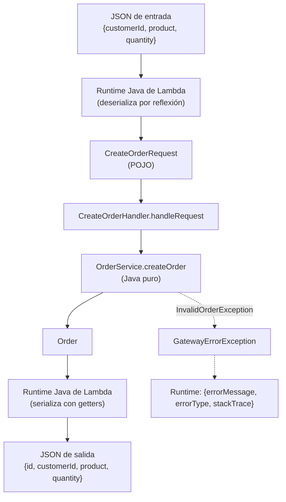

## 7. Arquitectura A — mapping templates

Configuración completa en [`docs/ARCH_A_GATEWAY_SETUP.md`](docs/ARCH_A_GATEWAY_SETUP.md).

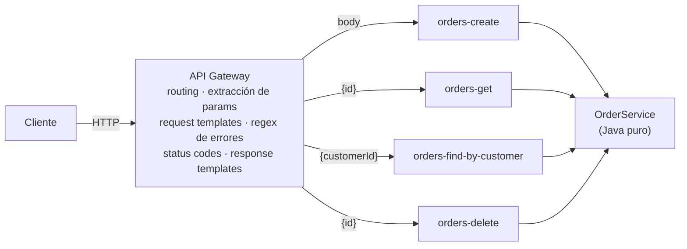

Se despliega con `./scripts/aws/deploy.sh arch-a`. El script es la configuración versionada:
cada método tiene su plantilla de request, sus *method responses* y sus *integration responses*
con regex.

### Resultados observados (curl desde CloudShell)

| Petición | Esperado | Observado |
|---|---|---|
| `GET /orders/ORD-100` | 200 + orden | ✅ 200 |
| `GET /orders/ORD-999` | 404 `ORDER_NOT_FOUND` | ✅ 404 |
| `GET /orders?customerId=CUST-42` | 200 + 2 órdenes | ✅ 200 |
| `GET /orders?customerId=CUST-100` | 200 `[]` | ✅ 200 `[]` |
| `GET /orders` (sin `customerId`) | 400 `INVALID_REQUEST` | ✅ 400 |
| `POST /orders` válido | 201 + `Location` | ✅ 201, `location: /orders/ORD-001` |
| `POST /orders` con `product: ""` | 400 `INVALID_REQUEST` | ✅ 400 |
| `POST /orders` con `quantity: "abc"` | 400 | ✅ 400 `MALFORMED_JSON` (lo arma la plantilla VTL, porque el error viene del runtime) |
| `POST /orders` con `{not json` | 400 `MALFORMED_JSON` | ⚠️ 400 `{"message": "Could not process payload"}`: la plantilla `$input.json('$')` falla en API Gateway y la Lambda no se invoca, así que el formato es el de API Gateway |
| `GET /orders/ORD-001` justo después del POST | — | ⚠️ **404**: `orders-get` es otra Lambda con otra memoria |
| `DELETE /orders/ORD-102` | 204 | ✅ 204 |
| `DELETE /orders/ORD-999` | 404 | ✅ 404 |
| `GET /orders/ORD-102` después del DELETE | — | ⚠️ **200**: `orders-delete` borró en *su* memoria, `orders-get` no se enteró |

Los dos ⚠️ no son errores del código: son la consecuencia directa de combinar *una Lambda por
operación* con almacenamiento en memoria. Con una base de datos compartida desaparecerían.

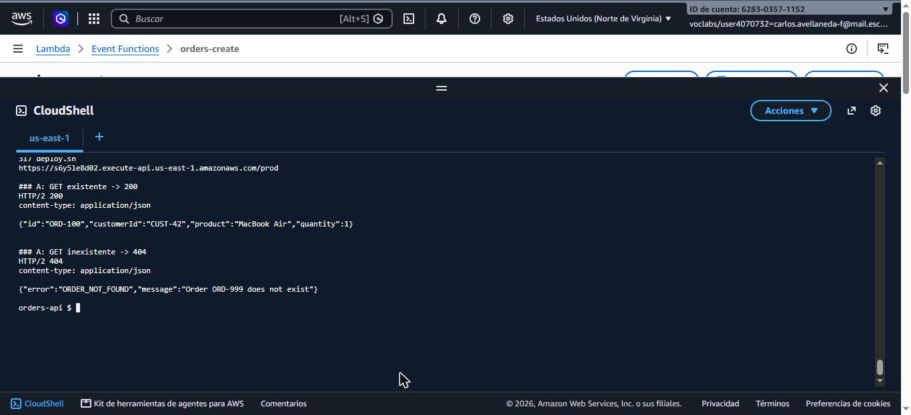
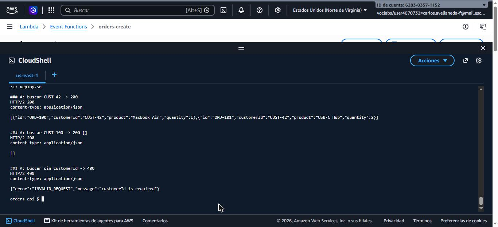
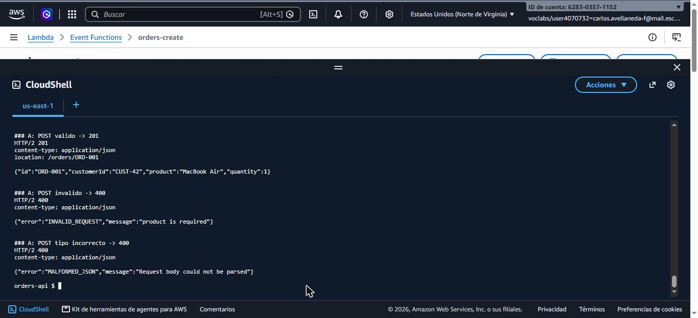
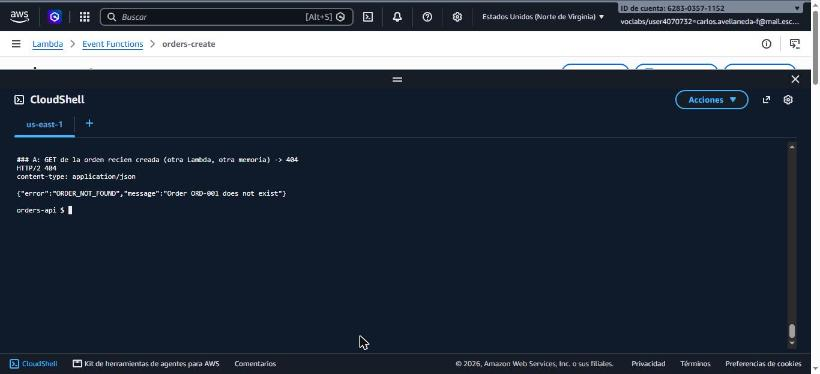
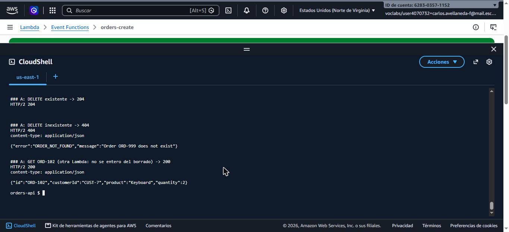

### Checkpoint 3 — responsabilidades de API Gateway

En esta arquitectura API Gateway es responsable de:

- **Enrutar** cada método y recurso a una Lambda distinta.
- **Extraer** el path param `id` y el query param `customerId`.
- **Transformar el request** HTTP en el JSON exacto que espera cada handler.
- **Elegir el status code**: 200/201 por defecto; 400/404/500 aplicando regex sobre `errorMessage`.
- **Transformar la respuesta de error** (sacar `errorMessage` y ocultar el `stackTrace`).
- **Agregar el header `Location`** en el 201 (con `$context.responseOverride`).

**Ventajas**

- El código Java no sabe nada de HTTP; los handlers reciben objetos simples.
- El contrato HTTP es visible en la consola de API Gateway.
- Cada Lambda es pequeña y tiene una sola responsabilidad.

**Desventajas**

- La lógica HTTP queda repartida en plantillas VTL y regex fuera del código: no tiene tests
  unitarios ni revisión de código natural, y solo se prueba desplegando.
- Acoplamiento implícito: el texto de `errorMessage` debe coincidir con regex configurados a
  mano. Si cambia el código del error y no el regex, el cliente recibe **200** con un error.
- Mucha configuración repetida por cada método (plantilla de request, 3–4 integration
  responses, method responses).
- Cada operación es una Lambda con memoria propia: lo creado por POST no lo ve el GET, y lo
  borrado por DELETE sigue apareciendo en el GET (comprobado en AWS, ver tabla anterior).
- Errores fuera de nuestro control: al desplegar, durante unos segundos API Gateway respondió
  `403 Missing Authentication Token` (su respuesta para rutas que todavía no conoce), con un
  formato distinto al nuestro.

## 8. Arquitectura B — proxy + adaptador HTTP

Configuración en [`docs/ARCH_B_PROXY_SETUP.md`](docs/ARCH_B_PROXY_SETUP.md); se despliega con
`./scripts/aws/deploy.sh arch-b`.

Eventos **reales** capturados en CloudWatch (activando temporalmente la variable `LOG_EVENTS=true`
en la Lambda): [`events/proxy-event-real-post.json`](events/proxy-event-real-post.json) y
[`events/proxy-event-real-get.json`](events/proxy-event-real-get.json). El test
`handlesRealPostEventCapturedInCloudWatch` vuelve a ejecutar el POST real localmente.
Nota: se registraron serializando el objeto `APIGatewayProxyRequestEvent`, por eso aparecen
campos con `null` (como `version`) que API Gateway no envía.

| Dato | Campo del evento |
|---|---|
| Método HTTP | `httpMethod` |
| Path | `path` (real) y `resource` (plantilla, p. ej. `/orders/{id}`) |
| Path params | `pathParameters` |
| Query params | `queryStringParameters` |
| Headers | `headers` / `multiValueHeaders` |
| Body | `body` — llega como **string** (`"{\"customerId\":...}"`), hay que parsearlo |
| Stage, IP, request id | `requestContext` (`stage: "prod"`, `identity.sourceIp`, `requestId`) |

`OrdersApiHandler` es el adaptador: enruta por `resource` + `httpMethod`, extrae parámetros,
parsea el body, llama a `OrderService` y traduce resultados y excepciones a respuestas HTTP.
`OrderService` no cambió respecto a la Parte I.

| Excepción / resultado | Respuesta |
|---|---|
| Orden creada | 201 + `Location` |
| Orden encontrada / búsqueda | 200 |
| `InvalidOrderException` | 400 `INVALID_REQUEST` |
| Body ausente o JSON inválido | 400 `MALFORMED_JSON` |
| `OrderNotFoundException` | 404 `ORDER_NOT_FOUND` |
| Método no soportado | 405 `METHOD_NOT_ALLOWED` |
| Cualquier otra excepción | 500 `INTERNAL_ERROR` |
| Orden eliminada | 204 sin body |

### Resultados observados (curl desde CloudShell)

| Petición | Esperado | Observado |
|---|---|---|
| `POST /orders` válido | 201 + `Location` | ✅ 201, `location: /orders/ORD-001` |
| `GET /orders/ORD-001` justo después | 200 | ✅ 200 (misma Lambda, misma memoria) |
| `GET /orders/ORD-999` | 404 | ✅ 404 |
| `GET /orders?customerId=CUST-42` | 200 | ✅ 200 (incluye la orden recién creada) |
| `GET /orders` (sin `customerId`) | 400 | ✅ 400 `INVALID_REQUEST` |
| `POST` con `product: ""` | 400 | ✅ 400 `INVALID_REQUEST` |
| `POST` con `{not json` | 400 | ✅ 400 `MALFORMED_JSON` |
| `DELETE /orders/ORD-100` | 204 | ✅ 204 sin body |
| `GET /orders/ORD-100` después | 404 | ✅ 404 |
| `DELETE /orders/ORD-999` | 404 | ✅ 404 |

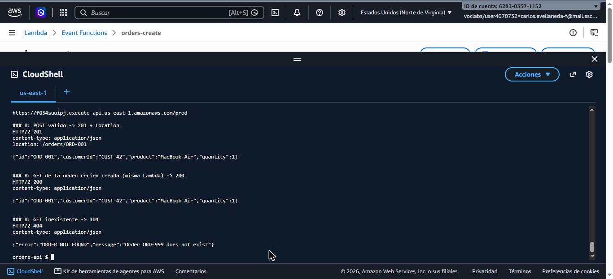
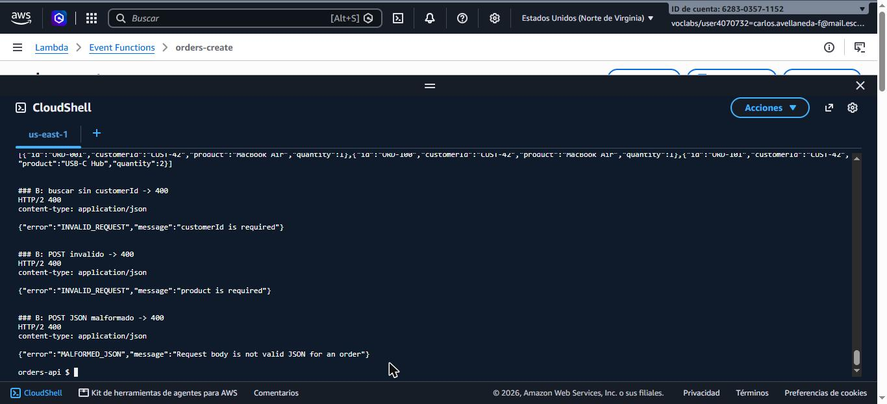
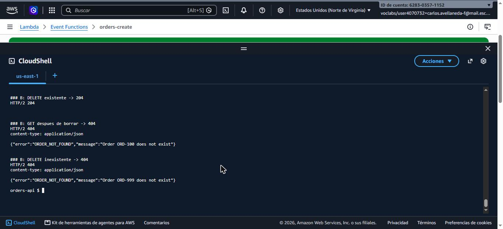

## 9. Comparación de arquitecturas


| Pregunta | Arquitectura A (no-proxy) | Arquitectura B (proxy) |
|---|---|---|
| ¿Más configuración en API Gateway? | **Sí, mucha más**: en `deploy.sh` cada método necesita ~9 llamadas (método, integración con plantilla, 3–4 *method responses*, 3–4 *integration responses* con regex y plantillas) y 8 plantillas VTL. | 2 llamadas por método (método + integración `AWS_PROXY`). |
| ¿Más código Java de infraestructura? | 143 líneas (4 handlers, 2 DTOs de entrada, traductor de errores). Sorprendentemente parecido a B. | 123 líneas (un handler-router con el mapeo HTTP). |
| ¿Más fácil de probar localmente? | Solo la mitad: los handlers sí; las plantillas VTL y los regex solo se prueban desplegados. | **Todo**: el comportamiento HTTP completo se prueba con eventos simulados (`OrdersApiHandlerTest`). |
| ¿Dónde se definen los status codes? | En API Gateway (integration responses + regex). | En Java (`OrdersApiHandler`). |
| ¿Cuánto costó agregar DELETE? (medido) | Una Lambda nueva (`orders-delete`), un handler nuevo y ~9 llamadas de configuración (plantilla, 204/400/404/500). Y aun así quedó inconsistente con `orders-get`. | Un `case "DELETE"` en el router y una línea en `deploy.sh` (`proxy_method ... DELETE`). |
| ¿Qué pasa con 30 operaciones? | 30 métodos con plantillas y regex repetidos; probablemente 30 Lambdas. Se vuelve inmanejable sin infraestructura como código. | Crece el router; habría que extraer rutas o usar una librería, pero la configuración de API Gateway sigue siendo trivial (incluso `/{proxy+}`). |
| ¿Lógica de negocio más limpia? | Igual de limpia en ambas: `OrderService` es idéntico. A tiene handlers "más puros", pero a costa de mover lógica HTTP a la consola. | Igual. El HTTP queda concentrado en una sola clase. |
| ¿Más fácil de entender para otro desarrollador? | Hay que leer código **y** la configuración de API Gateway para entender un error 404. | Todo el comportamiento está en el repositorio, en un solo lenguaje. |
| ¿Cuál elegiría para un sistema grande? | No. Solo la usaría si necesito que API Gateway valide o transforme el request antes de invocar Lambda, o para integrar API Gateway directamente con otro servicio de AWS sin Lambda de por medio. | **B.** Todo el comportamiento HTTP se prueba sin desplegar (20 tests en `OrdersApiHandlerTest`), mientras que en A las plantillas y los regex solo los pude verificar en AWS. Agregar DELETE me costó un `case` en el router y una línea en `deploy.sh`, frente a una Lambda nueva y ~9 llamadas de configuración en A. Y en A comprobé en AWS que lo creado con POST y lo borrado con DELETE no se reflejaba en el GET (§7); en B el mismo flujo funcionó (§8). |

## 10. Revisión crítica de decisiones

Las decisiones de diseño están registradas en [`docs/DECISIONS.md`](docs/DECISIONS.md) (D1–D14).
Analizo tres de ellas.

### Decisión 1: D3 — formato de errores en la arquitectura A

- **Decisión:** en A, el handler captura la excepción de dominio y lanza `GatewayErrorException`,
  cuyo `errorMessage` es el JSON de error completo (`{"error":"ORDER_NOT_FOUND","message":"..."}`).
  API Gateway aplica regex sobre ese texto para elegir el status code y la plantilla lo devuelve tal cual.
  La primera versión ponía el prefijo (`ORDER_NOT_FOUND: ...`) directamente en las excepciones de dominio.
- **¿Por qué se propuso?** En la integración no-proxy la Lambda no puede fijar el status code; lo único
  que API Gateway ve de un error es `errorMessage`. Poner el código en el mensaje de la excepción de
  dominio era la forma más corta de que el regex lo encontrara.
- **¿Estoy de acuerdo?** Sí, con el cambio. El formato que necesita API Gateway es un detalle de
  integración; si queda en el dominio, `OrderNotFoundException` termina dependiendo de cómo está
  configurada una arquitectura concreta. Ahora el prefijo vive solo en `lambda.mapping`, y
  `ArchitectureTest` sigue garantizando que el dominio no conoce la capa Lambda.
- **¿Qué alternativa se podía usar?** Un prefijo de texto y una plantilla VTL que arme el JSON, o
  devolver un objeto "exitoso" con un campo `status` y usar `$context.responseOverride.status`.
  Esta última evita excepciones, pero hace que cada error cuente como invocación correcta en las
  métricas de Lambda.
- **¿Qué implementé finalmente y por qué?** El JSON completo en `errorMessage`, construido en el
  handler. La plantilla de error solo tiene que devolver el mensaje, y `MappingHandlersTest`
  comprueba que los errores coinciden con el regex de su status code. Queda el riesgo de que un
  error que no coincida con ningún regex llegue al cliente como 200.

### Decisión 2: D1 + D4 — una Lambda por operación en A, con almacenamiento en memoria

- **Decisión:** en A hay cuatro Lambdas (`orders-create`, `orders-get`, `orders-find-by-customer`,
  `orders-delete`), cada una con su propio `InMemoryOrderRepository` y los datos de ejemplo
  `ORD-100`, `ORD-101` y `ORD-102` precargados.
- **¿Por qué se propuso?** En A, API Gateway ya enruta y transforma cada método hacia una entrada
  distinta, así que un handler por operación es lo natural. Los datos semilla son la única forma de
  demostrar un GET 200 cuando cada función tiene su propia memoria.
- **¿Estoy de acuerdo?** Para el taller, sí: mantiene cada handler pequeño y hace visible lo que
  hace API Gateway. Pero el problema es real y lo vi en AWS: después de un POST, `GET /orders/ORD-001`
  respondió 404, y después de `DELETE /orders/ORD-102` (204) el GET de esa orden siguió dando 200.
  El API queda inconsistente aunque el código sea correcto.
- **¿Qué alternativa se podía usar?** Un almacenamiento compartido (por ejemplo DynamoDB, que solo
  requiere otra implementación de `OrderRepository`) o una sola Lambda para todas las operaciones de A,
  con un campo `"operation"` puesto por la plantilla.
- **¿Qué implementé finalmente y por qué?** Mantuve una Lambda por operación con memoria propia,
  porque el taller no incluye base de datos y así se ve la diferencia con B. Documenté la
  inconsistencia en §7 y en [`docs/DEPLOY_NOTES.md`](docs/DEPLOY_NOTES.md). En producción usaría un
  almacenamiento compartido o una sola Lambda.

### Decisión 3: D13 — despliegue con un script de AWS CLI

- **Decisión:** toda la configuración de Lambda y API Gateway está en
  [`scripts/aws/deploy.sh`](scripts/aws/deploy.sh), un script idempotente que se ejecuta en CloudShell.
- **¿Por qué se propuso?** Configurar A en la consola son decenas de clics por método (plantillas,
  *method responses*, *integration responses* con regex). Un script lo hace reproducible y queda
  versionado con el código.
- **¿Estoy de acuerdo?** Sí. Me permitió recrear ambos APIs después de cambios (por ejemplo al
  agregar DELETE) sin repetir pasos a mano, y sirve como documentación exacta de la configuración.
  Su límite es que no lleva estado: si algo se cambia en la consola, el script no lo detecta.
- **¿Qué alternativa se podía usar?** AWS SAM o CloudFormation, que describen la infraestructura de
  forma declarativa y gestionan el estado y el borrado de recursos. También Terraform, o la consola
  web, que es más didáctica pero nada reproducible.
- **¿Qué implementé finalmente y por qué?** El script de AWS CLI, porque en AWS Academy ya tenía
  CloudShell con `aws`, `jq` y `curl`, y SAM agregaba conceptos nuevos que el taller no pedía.
  Para un proyecto que siga creciendo migraría a SAM/CloudFormation.

## 11. Extensión: DELETE

La predicción se escribió antes de implementar: [`docs/DELETE_PREDICTION.md`](docs/DELETE_PREDICTION.md)
(incluye la comparación con lo implementado).

**Qué cambió**

| Capa | Cambio |
|---|---|
| `OrderRepository` / `InMemoryOrderRepository` | `boolean deleteById(String id)` |
| `OrderService` | `deleteOrder(id)`: lanza `OrderNotFoundException` si no existe (decide el **hecho**, no el código HTTP) |
| Arquitectura A | Nuevo `DeleteOrderHandler` + Lambda `orders-delete` + método `DELETE` con integration responses 204/400/404/500 |
| Arquitectura B | `case "DELETE"` en `OrdersApiHandler` → 204 sin body; método `DELETE` con proxy en API Gateway |
| Tests | +5 en `OrderServiceTest`, +4 en `OrdersApiHandlerTest`, +2 en `MappingHandlersTest` |

**Dónde se decide 204 vs 404:** el servicio solo dice "se borró" o lanza `OrderNotFoundException`.
En B la traducción a 204/404 está en `OrdersApiHandler`; en A, en las *integration responses* de
API Gateway (default → 204, regex `ORDER_NOT_FOUND` → 404).

Resultados en AWS: ver las tablas de §7 y §8. Análisis de las decisiones en §10.

## 12. Errores internos inesperados

- **Arquitectura B:** cualquier excepción no prevista se registra en CloudWatch Logs y el
  cliente recibe `500 {"error":"INTERNAL_ERROR","message":"Unexpected internal error"}`.
  Probado en `OrdersApiHandlerTest.unexpectedErrorReturns500WithoutInternalDetails`.
- **Arquitectura A:** el handler convierte la excepción en `INTERNAL_ERROR` y API Gateway la
  mapea a 500 con el regex `.*("INTERNAL_ERROR"|Task timed out).*`. Si ocurre un error que
  no coincide con ningún regex, API Gateway devuelve la respuesta por defecto (**200**): es la
  principal debilidad de esta arquitectura.
- Si la Lambda supera su *timeout* o falla el runtime, en B API Gateway responde
  `502 Bad Gateway` con su propio formato (fuera de nuestro control).
- Rutas o métodos que API Gateway no conoce reciben `403 {"message":"Missing Authentication Token"}`
  (observado en `DELETE /orders` y durante unos segundos tras un despliegue). Se podría unificar
  el formato con *Gateway Responses*.

## 13. Arquitectura final

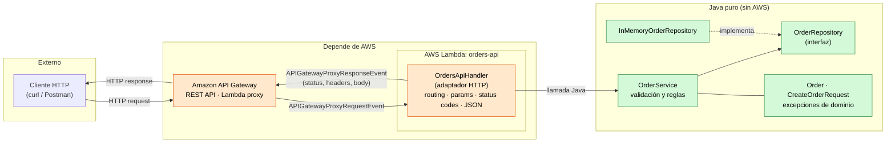

- 🟧 **Depende de AWS:** API Gateway, Lambda y `OrdersApiHandler` (usa `aws-lambda-java-events`).
- 🟩 **Java puro:** `OrderService`, `OrderRepository`, `InMemoryOrderRepository` y el dominio.
- Las dependencias apuntan **hacia adentro**: el adaptador conoce al servicio; el servicio no conoce al adaptador.

## 14. Ejemplos de requests y responses

Respuestas verificadas con `curl` contra los APIs desplegados:

- Arquitectura A: `https://s6y5le8d02.execute-api.us-east-1.amazonaws.com/prod`
- Arquitectura B: `https://f034suuipj.execute-api.us-east-1.amazonaws.com/prod`

Las rutas de abajo son relativas a cualquiera de las dos URLs; ambas devuelven lo mismo salvo
donde se indica. El 201 se ve en las capturas de §7 y §8.

**Crear orden — 201**

```http
POST /orders
Content-Type: application/json

{"customerId":"CUST-42","product":"MacBook Air","quantity":1}
```
```http
HTTP/1.1 201 Created
Content-Type: application/json
Location: /orders/ORD-001

{"id":"ORD-001","customerId":"CUST-42","product":"MacBook Air","quantity":1}
```

**Consultar orden existente — 200**

```http
GET /orders/ORD-102
```
```http
HTTP/1.1 200 OK

{"id":"ORD-102","customerId":"CUST-7","product":"Keyboard","quantity":2}
```

**Orden inexistente — 404**

```http
GET /orders/ORD-999
```
```http
HTTP/1.1 404 Not Found

{"error":"ORDER_NOT_FOUND","message":"Order ORD-999 does not exist"}
```

**Buscar por cliente — 200**

```http
GET /orders?customerId=CUST-42
```
```http
HTTP/1.1 200 OK

[{"id":"ORD-100","customerId":"CUST-42","product":"MacBook Air","quantity":1},
 {"id":"ORD-101","customerId":"CUST-42","product":"USB-C Hub","quantity":2}]
```

`GET /orders?customerId=CUST-100` → `200 []`

**Entrada inválida — 400**

```http
POST /orders
Content-Type: application/json

{"customerId":"CUST-42","product":"","quantity":0}
```
```http
HTTP/1.1 400 Bad Request

{"error":"INVALID_REQUEST","message":"product is required"}
```

**JSON malformado — 400**

```http
POST /orders
Content-Type: application/json

{not json
```
```http
HTTP/1.1 400 Bad Request

{"error":"MALFORMED_JSON","message":"Request body is not valid JSON for an order"}
```

Esa es la respuesta de B. En A, API Gateway rechaza el body antes de invocar la Lambda y responde
`400 {"message": "Could not process payload"}`. Con un tipo incorrecto (`"quantity":"abc"`), A sí
devuelve `400 {"error":"MALFORMED_JSON","message":"Request body could not be parsed"}`.

---

## Pendientes para la entrega

- [ ] Grabar el video y agregar el enlace.
- [ ] Commit y push del repositorio.
